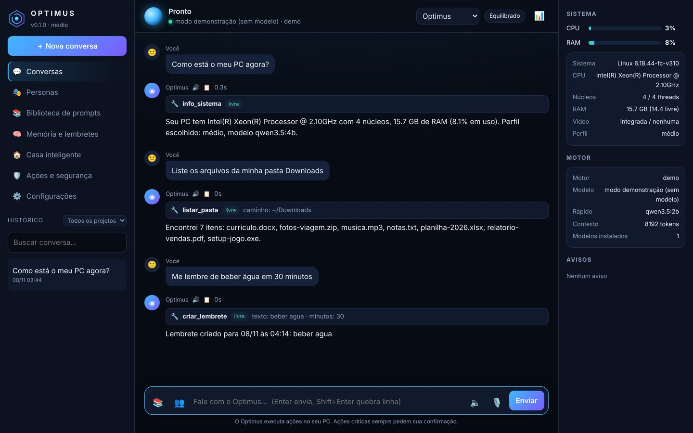
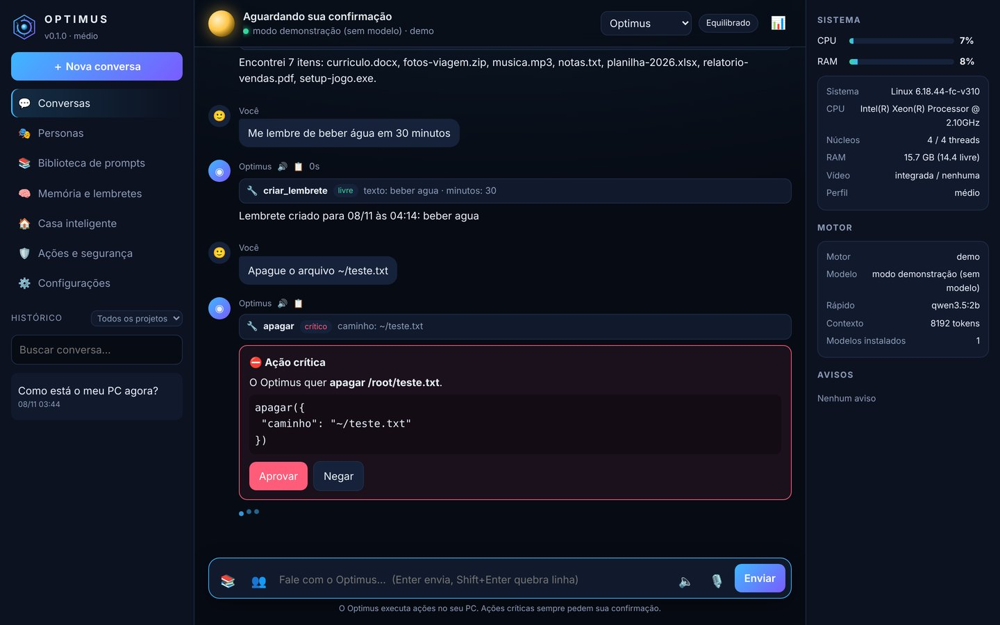
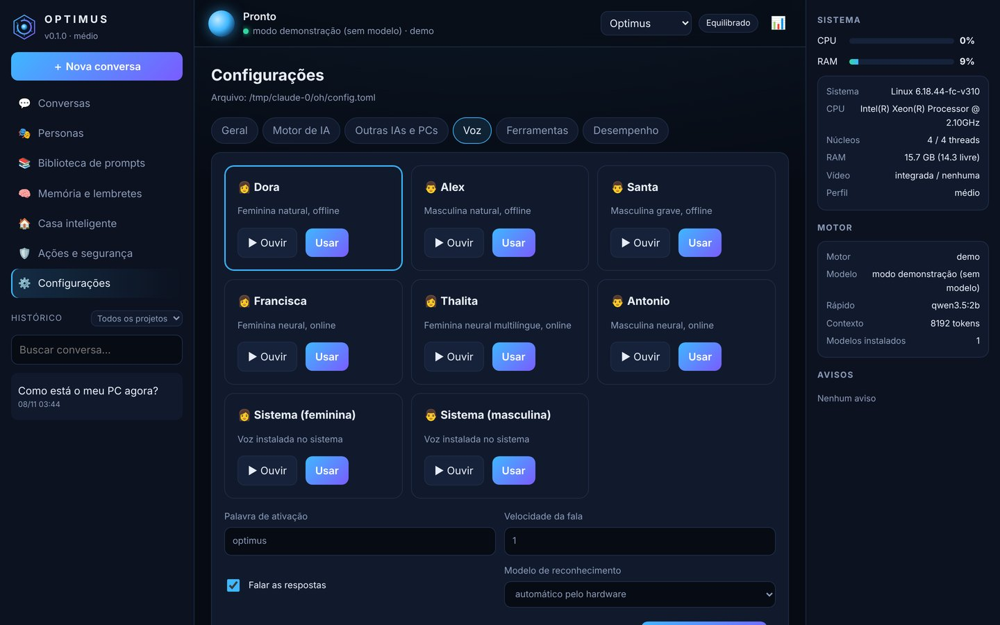
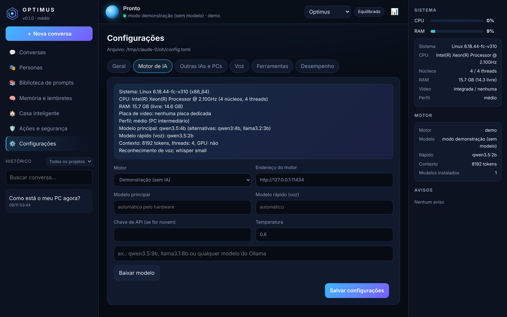
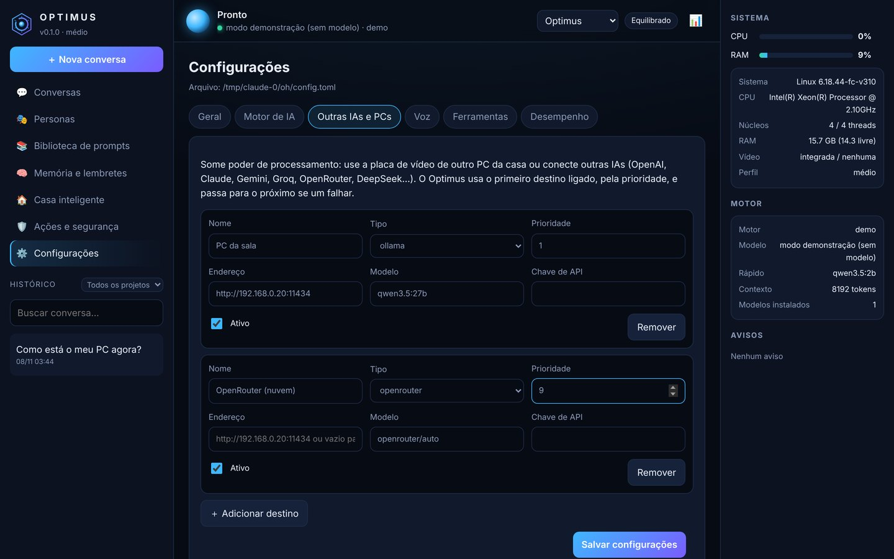
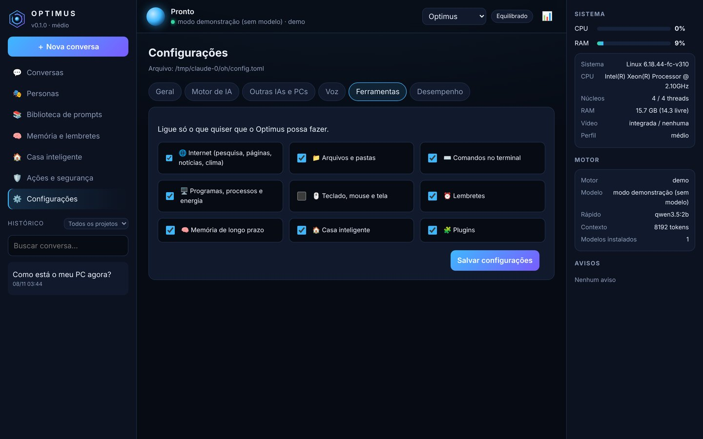
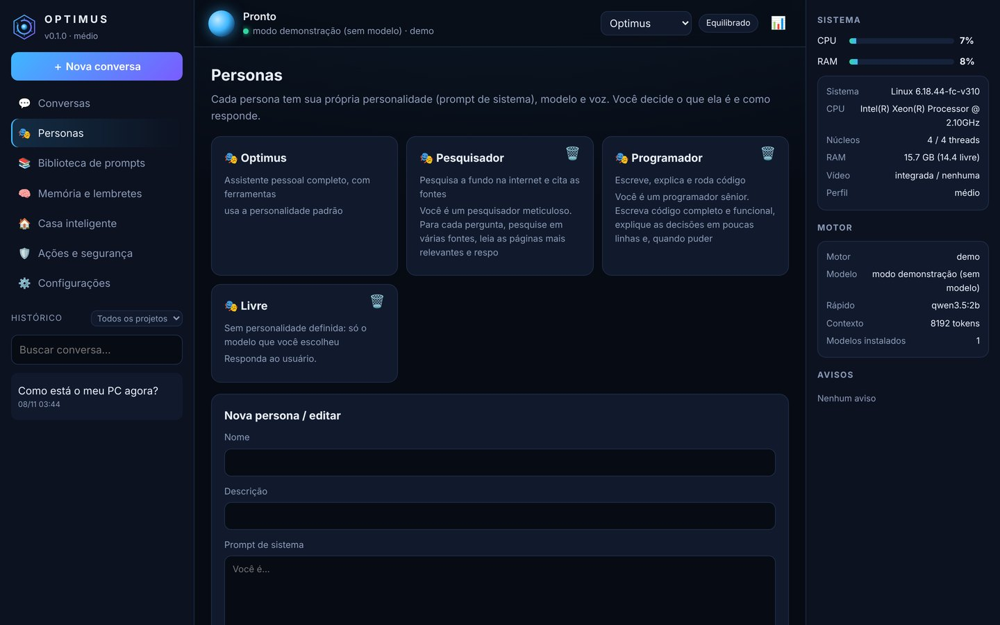
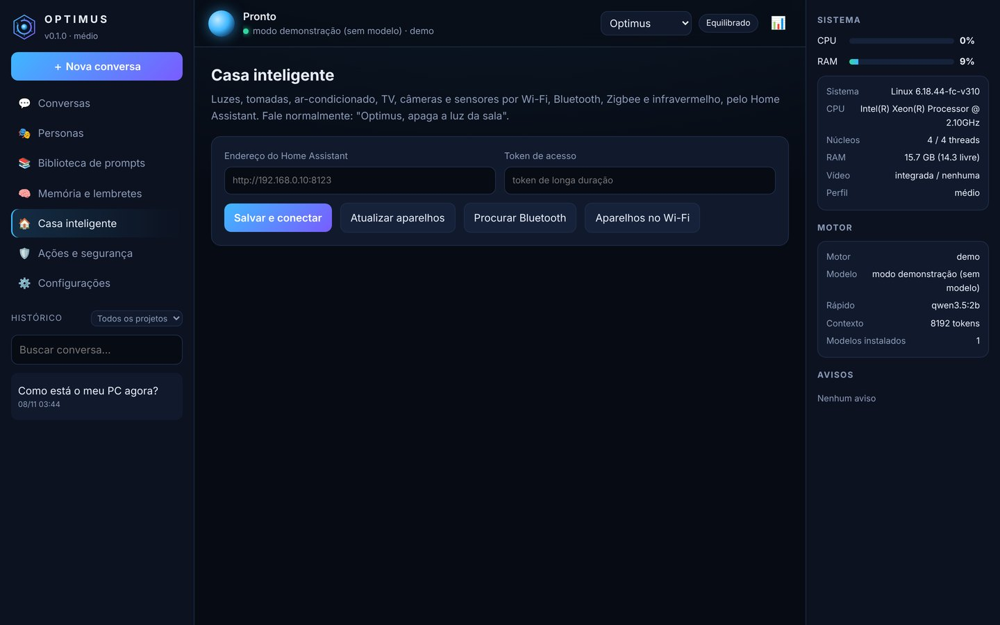
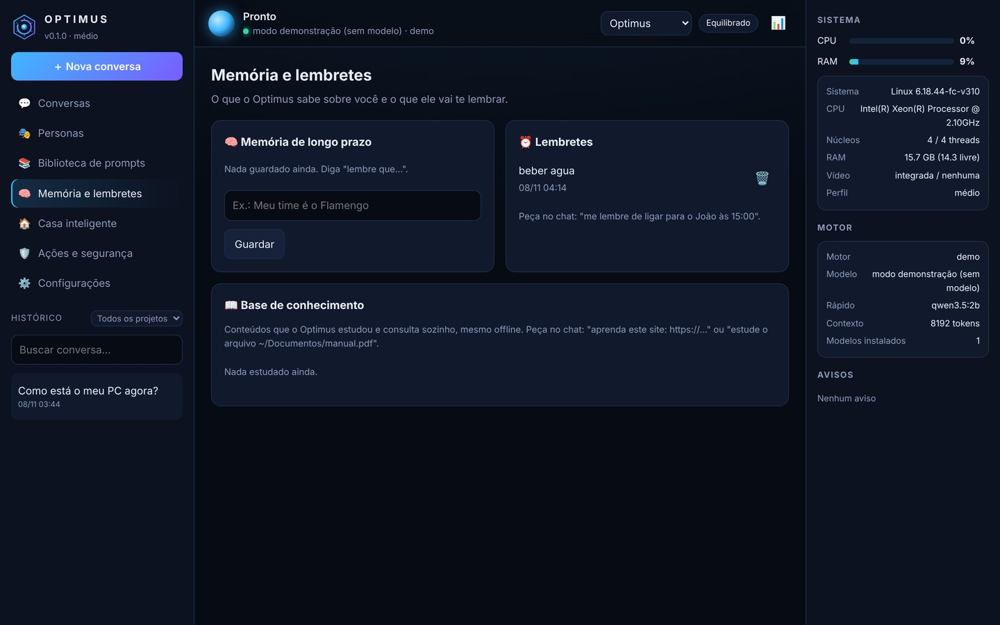
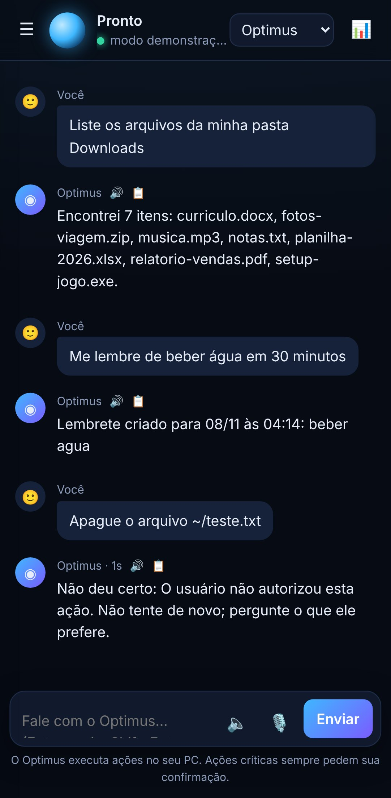

<div align="center">


# Optimus

**Assistente de IA pessoal, autônomo e de código aberto, que roda no seu próprio computador.
Conversa por voz, pesquisa na internet, controla o PC e a casa, aprende e lembra. Windows, Linux e Android.**

[](https://github.com/Edton180/Open-Optimus-IA-Assistente-/actions/workflows/ci.yml)


Desenvolvido por **Edton Braz** ([@Edton180](https://github.com/Edton180))

</div>

> [!WARNING]
> **Aviso de responsabilidade.** O Optimus é um software livre que executa ações reais no seu computador
> (arquivos, programas, comandos, internet e aparelhos da casa) e responde com o modelo de IA que **você**
> escolher, sem filtros de conteúdo adicionados pelo aplicativo. **Todo o uso, as respostas geradas e as
> consequências das ações são de inteira responsabilidade de quem instala e opera o sistema.** Use de acordo
> com a lei do seu país e os termos dos serviços que você conectar. O software é fornecido "como está", sem
> garantias, conforme a [Licença Apache 2.0](LICENSE).

## O que é

O Optimus é um agente de IA que mora no seu PC. Você fala ou escreve, e ele **entende, decide e faz**:
pesquisa na internet, lê páginas, organiza arquivos, abre programas, roda comandos, cria lembretes,
controla luzes, tomadas, TV e ar-condicionado, tira foto das câmeras, aprende com sites e documentos e
lembra do que você contou. Tudo com a sua aprovação nas ações perigosas.

O cérebro é um **modelo de IA local** (Ollama, llama.cpp, LM Studio...) que o Optimus **escolhe sozinho de
acordo com o seu hardware**: de um notebook com 4 GB de RAM até uma placa de vídeo de 24 GB. Funciona
**offline**. Se quiser mais força, ele usa a placa de vídeo de **outro PC da casa** ou **outras IAs**
(OpenAI, Claude, Gemini, Groq, OpenRouter, DeepSeek...), passando para a próxima se uma cair.

A personalidade é sua: você escolhe o modelo e escreve o prompt de sistema. O Optimus não acrescenta
nenhuma camada de censura nas conversas. A única proteção do aplicativo é nas **ações no computador**:
apagar, desligar, instalar e afins sempre pedem confirmação.

É inspirado no [OpenJarvis](https://github.com/open-jarvis/OpenJarvis) (Stanford, Apache 2.0) e em
projetos da comunidade, reescrito do zero com foco em voz, controle do PC, casa inteligente e PCs fracos.
Veja [o que mudou](docs/o-que-mudou.md).

## Telas

| | |
|---|---|
|  **Conversa com ferramentas** |  **Confirmação de ação crítica** |
|  **Vozes femininas e masculinas prontas** |  **Motor escolhido pelo hardware** |
|  **Outras IAs e outros PCs** |  **Você liga o que ele pode fazer** |
|  **Personas com prompt, modelo e voz** |  **Casa inteligente** |
|  **Memória, lembretes e conhecimento** |  **No celular** |

Todas as telas em [docs/telas.md](docs/telas.md). As capturas foram feitas no **modo demonstração**
(`optimus --demo`): as ferramentas rodaram de verdade (sistema, arquivos, lembretes, confirmação), mas as
frases de resposta vêm de regras simples, sem modelo de IA. Com o Ollama, as respostas vêm do modelo.

## Funções

| Grupo | O que faz |
|---|---|
| Motor de IA | Ollama, llama.cpp, LM Studio, vLLM ou qualquer API compatível com OpenAI. **Escolhe o modelo pelo hardware** (6 perfis, de 0,8 a 35 bilhões de parâmetros), modelo rápido para voz, **guarda de recursos** (troca para o modelo leve se faltar RAM, prioridade baixa, modo econômico), lê chamadas de ferramenta escritas no texto por modelos pequenos |
| Outras IAs e PCs | Usa a placa de vídeo de outro PC da rede, OpenAI, Claude, Gemini, Groq, OpenRouter, DeepSeek, Mistral; ordem de prioridade e troca automática se um falhar |
| Agente autônomo | Ciclo de ferramentas (ReAct), **modo autônomo** que planeja e executa até concluir (`optimus tarefa "..."`), roteador rápido para comandos óbvios, proteção contra laços |
| Internet | Pesquisa, notícias, leitura de páginas, clima (sem chave de API) |
| Controle do PC | Arquivos e pastas (listar, ler, criar, copiar, mover, apagar, buscar), comandos (PowerShell/bash), abrir programas e sites, processos, energia (desligar, reiniciar, suspender, bloquear), teclado, mouse, prints e área de transferência |
| Casa inteligente | Home Assistant (Wi-Fi, Bluetooth, Zigbee, Matter, **infravermelho**), câmeras (Home Assistant, http ou rtsp), procurar aparelhos Bluetooth, ver quem está no Wi-Fi |
| Voz | Palavra de ativação "Optimus", **modo conversa** (continua sem repetir o nome), reconhecimento offline (Whisper), **vozes naturais femininas e masculinas offline e online**, fala frase por frase, confirmação por voz |
| Memória | Fatos de longo prazo, **base de conhecimento** que aprende com sites, arquivos e PDFs e é consultada sozinha, lembretes e alarmes (com repetição) |
| Interface | Painel web local com histórico, **projetos**, **personas**, **biblioteca de prompts**, **conversa em grupo** (várias personas respondem), uso de CPU/RAM ao vivo, registro de ações, tema escuro, funciona no celular e pode virar app (PWA) |
| Segurança | 4 níveis de risco, 3 modos (seguro, equilibrado, autônomo), confirmação estrita (negação sempre vence), comandos que destroem o sistema bloqueados, registro de tudo com senhas mascaradas, senha para acesso pela rede |
| Extensível | Plugins: um arquivo `.py` com `@ferramenta` vira uma nova habilidade |

## Instalação rápida

**Windows 10/11** (PowerShell):

```powershell
git clone https://github.com/Edton180/Open-Optimus-IA-Assistente-.git optimus
cd optimus
powershell -ExecutionPolicy Bypass -File scripts\instalar.ps1
```

**Linux** (Ubuntu, Debian, Mint, Fedora, Arch):

```bash
git clone https://github.com/Edton180/Open-Optimus-IA-Assistente-.git optimus
cd optimus
bash scripts/instalar.sh
```

**Android** (Termux, pelo F-Droid, mais o app Termux:API):

```bash
pkg install git && git clone https://github.com/Edton180/Open-Optimus-IA-Assistente-.git optimus
cd optimus && bash scripts/instalar-android.sh
```

O instalador coloca o Python se faltar, instala o Optimus, **baixa as vozes naturais**, instala o
**Ollama**, **escolhe e baixa o modelo certo para o seu PC** e cria o atalho "Optimus". Depois é só abrir o
atalho ou rodar `optimus gui`.

Passo a passo, instalação manual e requisitos: [docs/instalacao.md](docs/instalacao.md).

## Primeiro uso

```bash
optimus gui                 # interface visual (abre no navegador)
optimus                     # conversa no terminal
optimus voz                 # fale "Optimus, que horas são?"
optimus tarefa "organize minha pasta Downloads por tipo de arquivo"   # modo autônomo
optimus hardware            # perfil escolhido para este PC
optimus doutor              # diagnóstico
optimus --demo gui          # testar a interface sem modelo de IA
```

Pedidos de exemplo: *"pesquise o preço do dólar hoje"*, *"abre o YouTube"*, *"me lembre de tomar remédio
às 21:00 todo dia"*, *"aprenda este site: https://..."*, *"apaga a luz da sala"*, *"quais programas estão
pesando no PC?"*, *"crie um arquivo com a lista de compras"*.

## Perfis de hardware

| Perfil | Memória útil | Modelo principal | Contexto | Voz (Whisper) |
|---|---|---|---|---|
| mínimo | até 3 GB | `qwen3.5:0.8b` | 2.048 | tiny |
| leve | até 6 GB | `qwen3.5:2b` | 4.096 | base |
| médio | até 10 GB | `qwen3.5:4b` | 8.192 | small |
| forte | até 20 GB | `qwen3.5:9b` | 16.384 | small |
| forte (CPU) | 22 GB+ sem placa | `qwen3.5:35b-a3b` (MoE, rápido na CPU) | 16.384 | small |
| ultra | até 40 GB de VRAM | `qwen3.5:27b` | 32.768 | large-v3-turbo |
| máximo | acima | `qwen3.5:35b-a3b` | 32.768 | large-v3-turbo |

Memória útil = VRAM da placa (se tiver 4 GB ou mais) ou a RAM que sobra para o sistema não travar.
Cada perfil tem alternativas caso o modelo não exista no seu Ollama, e você pode trocar por **qualquer
modelo** (`optimus config motor.modelo nome-do-modelo`). Detalhes em [docs/motor.md](docs/motor.md).

## Documentação

| Documento | Assunto |
|---|---|
| [docs/instalacao.md](docs/instalacao.md) | Windows, Linux, Android, instalação manual e requisitos |
| [docs/telas.md](docs/telas.md) | Todas as telas da interface |
| [docs/como-funciona.md](docs/como-funciona.md) | Agente, ferramentas, memória, personas e modo autônomo |
| [docs/motor.md](docs/motor.md) | Modelos, perfis de hardware, desempenho e modelos sem filtro |
| [docs/rede.md](docs/rede.md) | Usar outros PCs e outras IAs |
| [docs/voz.md](docs/voz.md) | Palavra de ativação, vozes e microfone |
| [docs/casa.md](docs/casa.md) | Home Assistant, Bluetooth, infravermelho e câmeras |
| [docs/seguranca.md](docs/seguranca.md) | Níveis de risco, modos e registro de ações |
| [docs/plugins.md](docs/plugins.md) | Criar novas habilidades |
| [docs/configuracao.md](docs/configuracao.md) | Todas as opções do `config.toml` |
| [docs/problemas.md](docs/problemas.md) | Erros comuns e soluções |
| [docs/o-que-mudou.md](docs/o-que-mudou.md) | Pesquisa sobre o OpenJarvis e o que o Optimus faz diferente |

## Estrutura

```
optimus/
├── agent.py           agente: roteador rápido, escolha de modelo, ciclo de ferramentas
├── hardware.py        detecção de CPU/RAM/placa e perfis
├── engine/            Ollama, API OpenAI, rede de destinos, modo demonstração
├── tools/             internet, arquivos, sistema, desktop, casa, memória (+ plugins)
├── voice/             reconhecimento (Whisper), vozes (Kokoro, Edge, sistema), conversa
├── safety.py          níveis de risco, confirmação e auditoria
├── banco.py           SQLite: conversas, projetos, memória, conhecimento, lembretes, personas
├── web/               servidor local e interface (HTML/CSS/JS sem dependências)
└── cli.py             comandos do terminal
scripts/               instaladores (Windows, Linux, Android)
tests/                 testes automáticos (python -m pytest)
```

## Contribua

O Optimus é livre e aberto, sob a [Licença Apache 2.0](LICENSE). Correções, novas ferramentas, vozes e
documentação são bem-vindas: abra uma issue ou envie um pull request. Antes, rode `python -m pytest`.
Créditos e inspirações em [NOTICE](NOTICE).
