# Telas do sistema

Capturas feitas no modo demonstração (`optimus --demo gui`), em um PC Linux com 4 núcleos e 16 GB de RAM,
sem placa de vídeo dedicada (perfil "médio"). As ferramentas executaram de verdade; as frases de resposta
vêm de regras simples, sem modelo de IA.

## Início

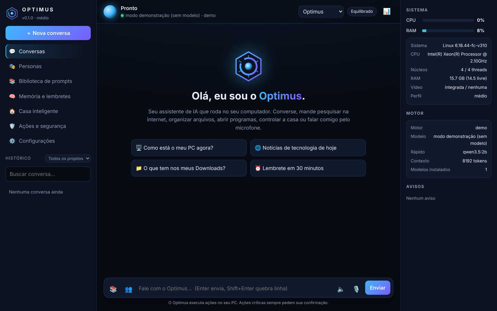

## Conversa usando ferramentas

O Optimus mostra cada ferramenta que usou, com o nível de risco. Clique no passo para ver o resultado.

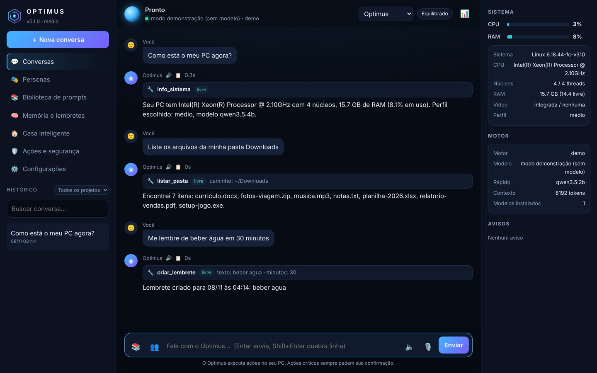

## Confirmação de ação crítica

Apagar, desligar, instalar e afins param e esperam a sua decisão.

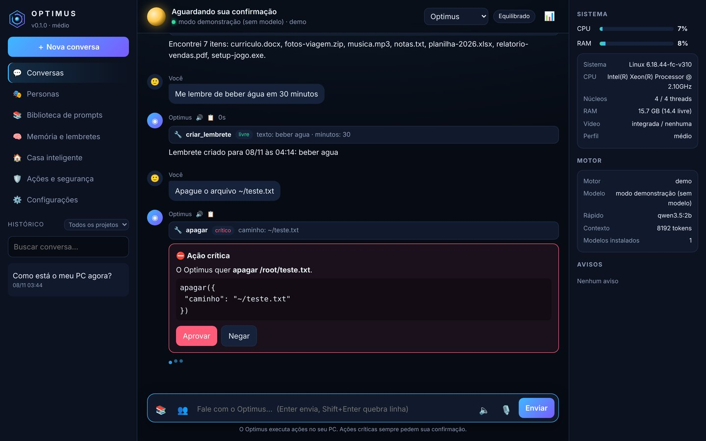

## Personas

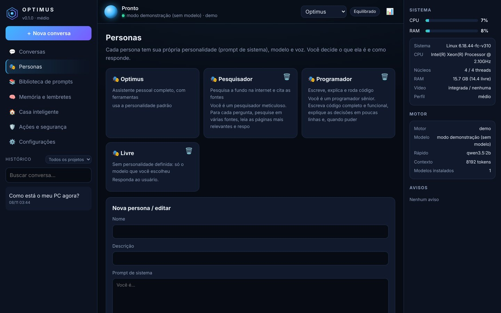

## Biblioteca de prompts

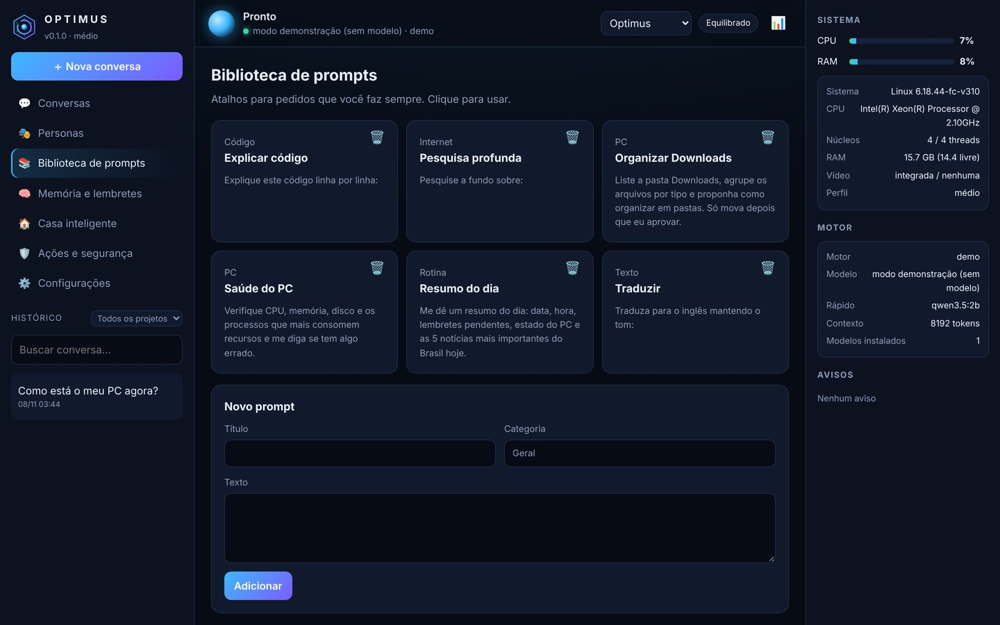

## Memória, lembretes e base de conhecimento

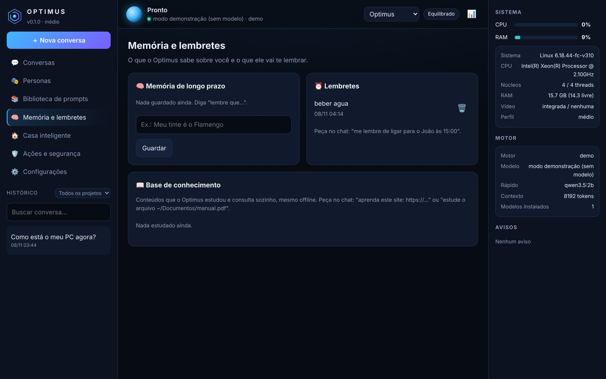

## Casa inteligente

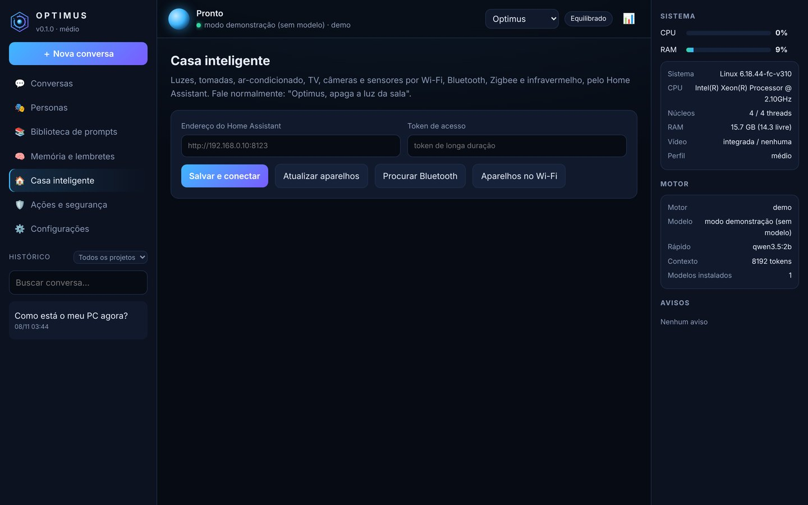

## Ações e segurança

Registro de tudo que foi executado, com a decisão tomada.

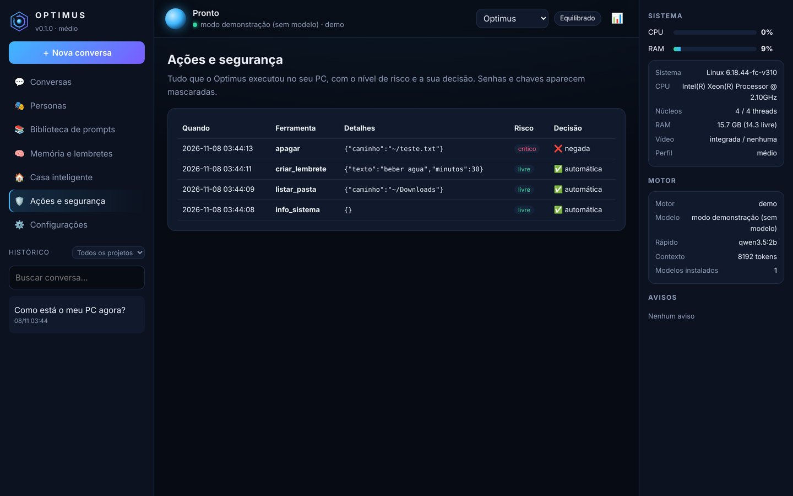

## Configurações

| | |
|---|---|
| 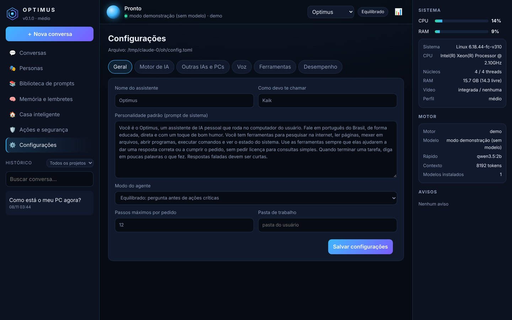 **Geral: nome, personalidade e modo** | 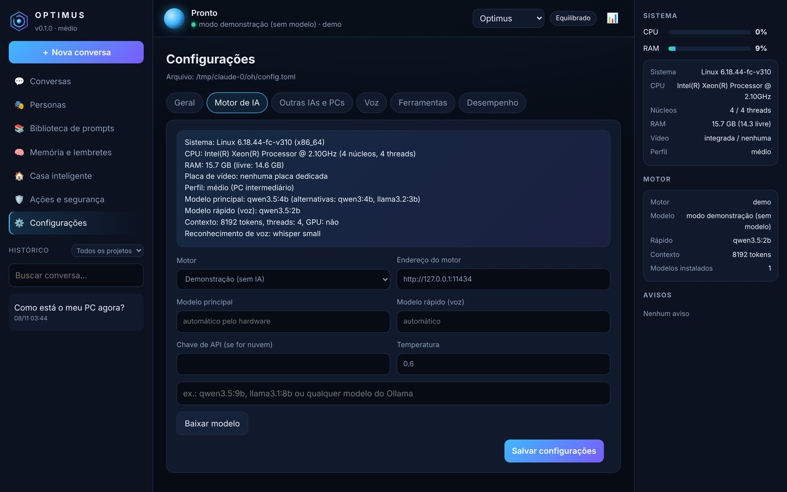 **Motor de IA e perfil do hardware** |
| 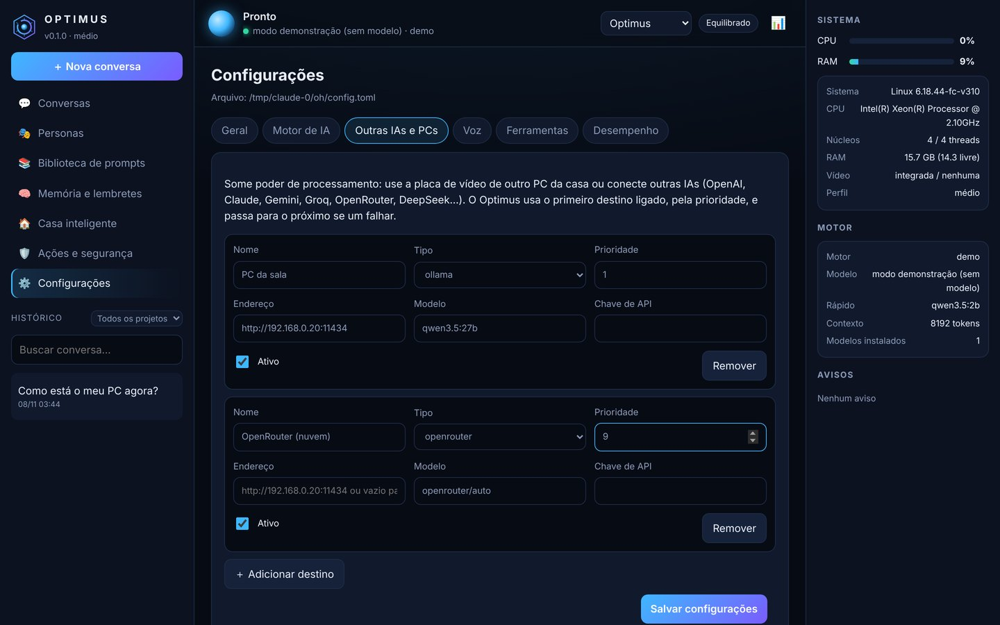 **Outras IAs e outros PCs** | 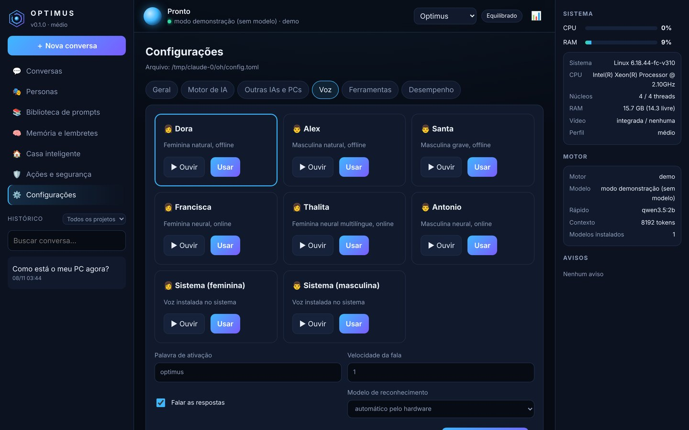 **Vozes** |
| 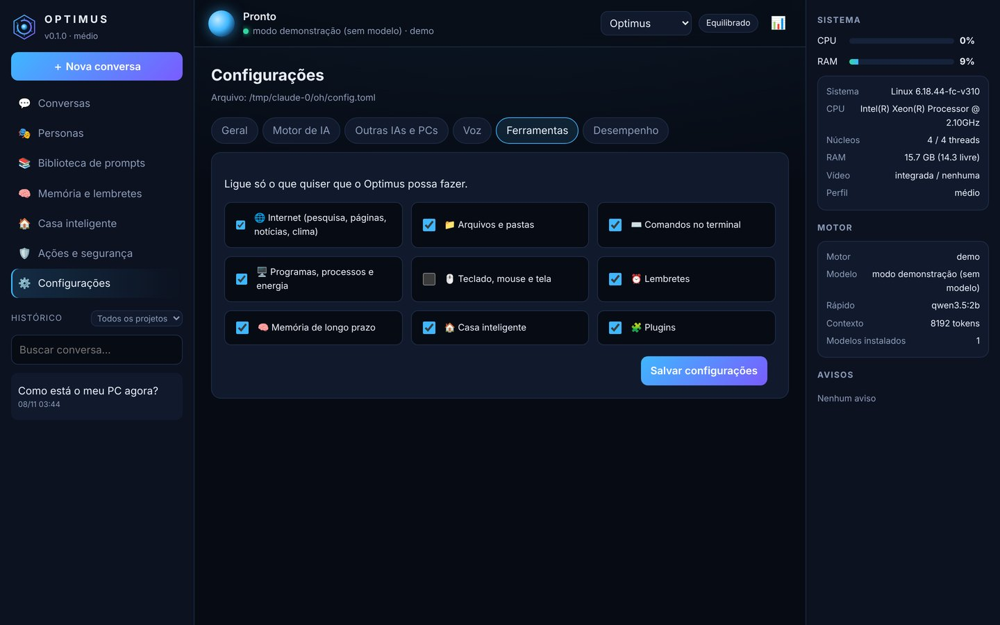 **Ferramentas liga/desliga** | 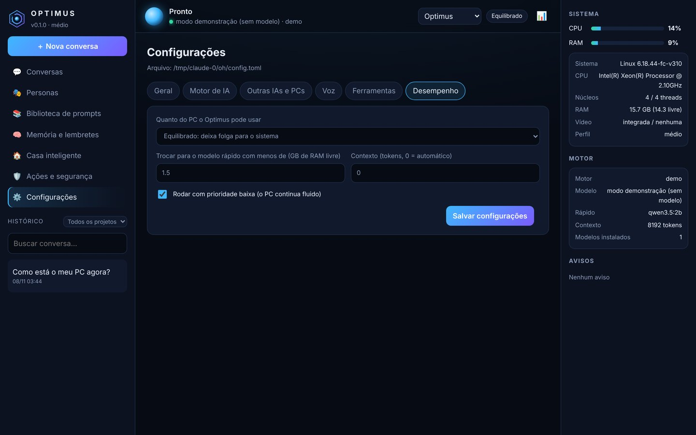 **Desempenho** |

## No celular

| | |
|---|---|
| 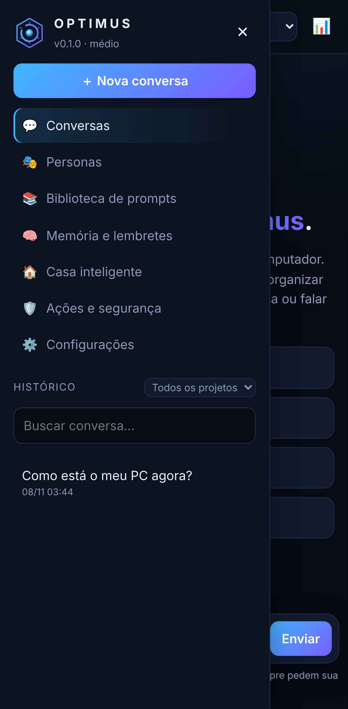 | 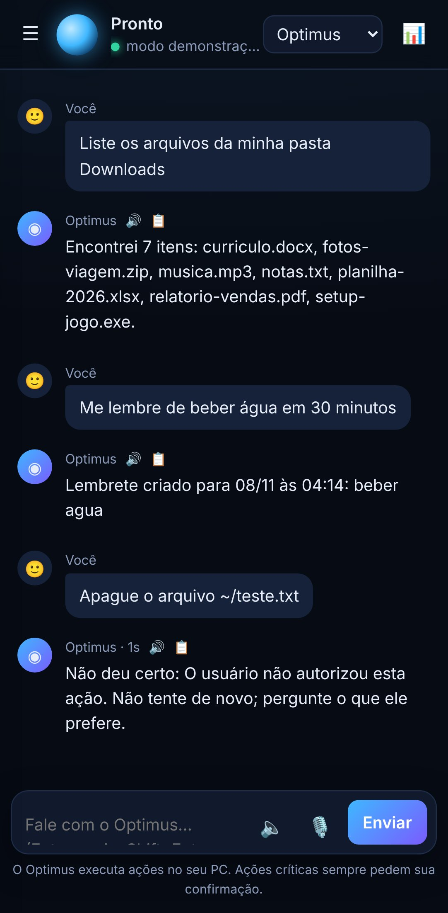 |
